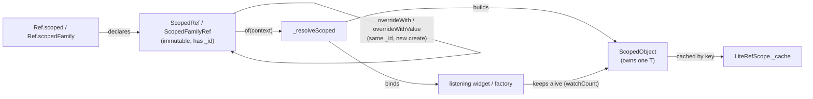
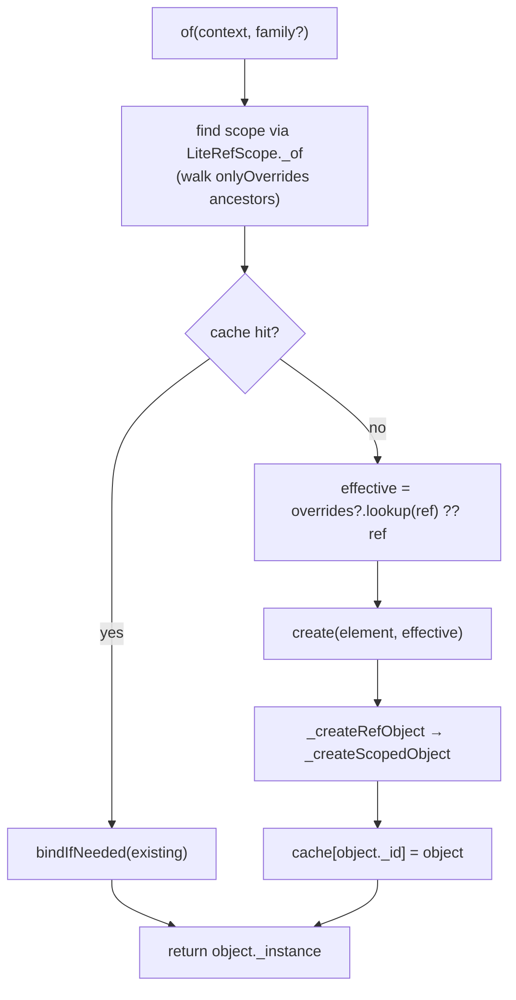
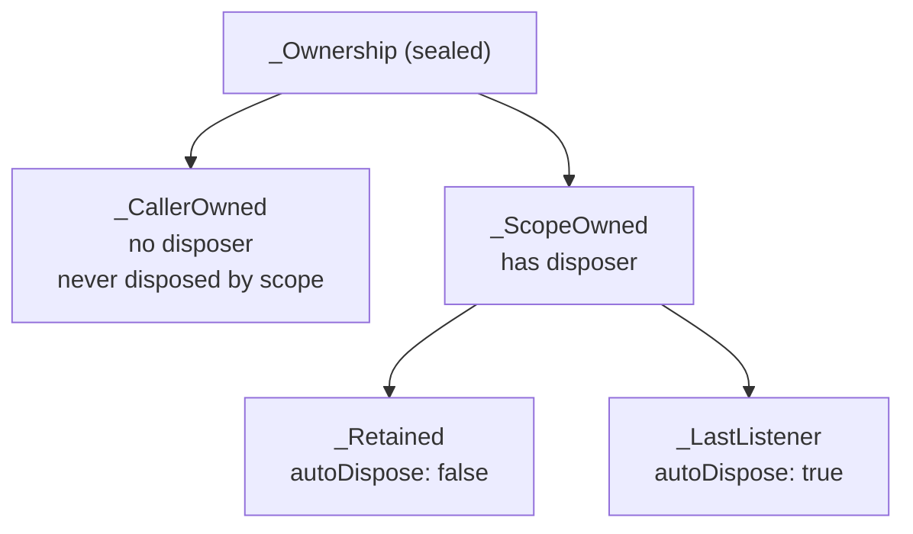
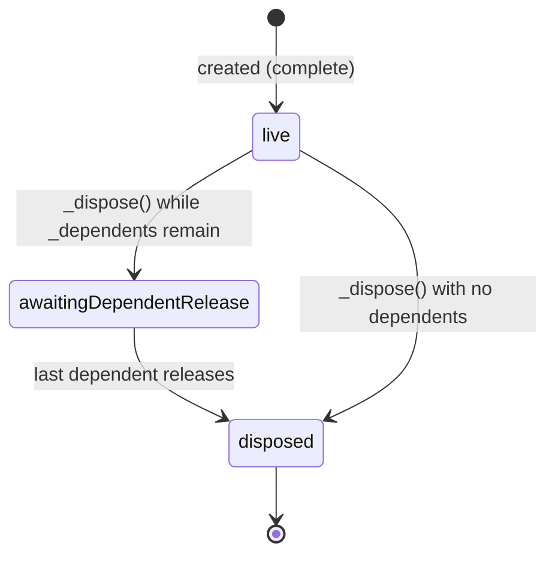
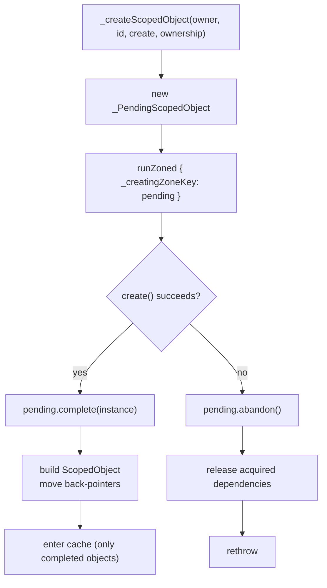
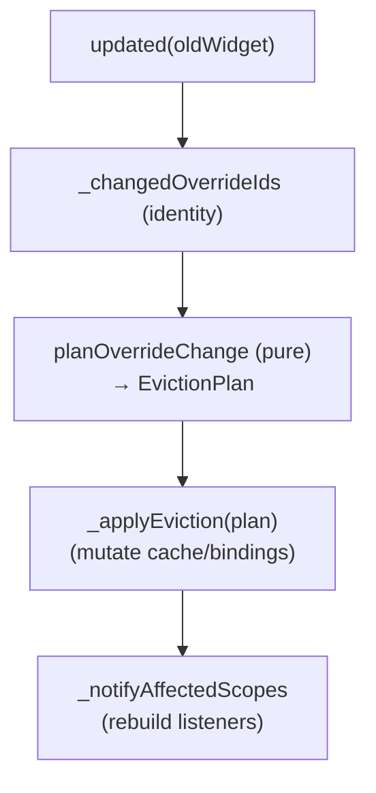

# Architecture: scoped refs

This explains how `ScopedRef`, `ScopedFamilyRef`, and `LiteRefScope` work under
the hood. It covers only the scoped implementation in `packages/lite_ref/lib` —
the `lite_ref_core` package (singletons, transients) is deliberately out of
scope.

## Mental model

There are two kinds of object that look similar but are not:

- **Refs are immutable descriptors.** A `ScopedRef<T>` holds a create function,
  a disposal policy, and an identity token (`_id`). It never holds an instance.
- **Objects hold instances.** A `ScopedObject<T>` is a mutable node that owns one
  `T`, tracks who depends on it, and decides when it dies.

Every scope (`LiteRefScope`) keeps a cache from a *key* to a `ScopedObject`.
Resolving a ref means finding the nearest scope, reading or building the object
for that key, and wiring up whatever is listening. Overrides are just new
descriptor instances that share the same `_id`, so they hit the same cache slot
but build with a different create function.

A guiding design goal is to make invalid states unrepresentable. What can be
pure (which objects to create, invalidate, dispose) is extracted into plain
functions; what must stay impure (the cache, binding maps, notifications,
post-frame scheduling, user disposers) stays in the element.

## File map

All scoped code lives in `packages/lite_ref/lib/src/scoped/` as parts of one
library (`scoped.dart`) so they can share private names:

| File | Owns |
| --- | --- |
| `scoped.dart` | library file; imports and `part` declarations |
| `i_scoped_ref.dart` | public typedefs (`CtxCreateFn`, `DisposeFn`, …) and the sealed `IScopedRef<T>` |
| `scoped_ref.dart` | `ScopedRef<T>` descriptor |
| `scoped_family_ref.dart` | `ScopedFamilyRef<T, F>` descriptor |
| `scoped_lookup.dart` | `_resolveScoped`, the single lookup path, plus `_creationContext` |
| `scoped_object.dart` | `_Ownership`, `_Lifecycle`, `_Dependent`, `ScopedObject`, `_PendingScopedObject`, `_createScopedObject` |
| `scoped_analysis.dart` | lite_ref-specific pure decisions: `_changedOverrideIds`, `_idOf` |
| `eviction.dart` | generic pure planners — `evictionOrder`, `keyBelongsTo`, `EvictionPlan`, `planEviction`, `planOverrideChange` (imported, not a part, so widget-free testable) |
| `scope_widget.dart` | `LiteRefScope` (the `InheritedWidget`) and `_RefScopeElement` (all Flutter effects) |

`src/ref.dart` holds the `Ref` static factories (`scoped`, `scopedFamily`, and
the pass-throughs to `lite_ref_core`). `lib/lite_ref.dart` is the public
surface; everything else is private.

## Ref identity and overrides

- `ScopedRef._id = Object()` — a fresh identity per declaration.
- `overrideWith` / `overrideWithValue` return a *new* `ScopedRef` that copies
  `_id` and the disposer, but swaps the create function or marks it caller-owned.
- Equality is by `_id`, so two overrides of the same ref are `==`. Because of
  this, change detection must compare by identity, not equality (see
  `_changedOverrideIds`).
- The cache key is `_id` for a `ScopedRef`, and `(_id, family)` for a
  `ScopedFamilyRef`. Dependency *lookup* tracking always uses the bare `_id`,
  never the family — families share a lookup path.

## Lookup (`_resolveScoped`)

One function serves both ref types. Parameters are the context, the descriptor,
a bare `lookupId`, a `cacheKey`, a `listen` flag, and a `create` callback that
knows how to build the object for the *effective* ref.

1. Find the serving element with `LiteRefScope._of`, which also returns any
   `onlyOverrides` scopes traversed along the way.
2. If the cache has the key, bind the listener to the existing object and return
   its instance.
3. Otherwise resolve `effective = overrides?.lookup(ref) ?? ref`, build the
   object, bind, cache it, and return.

Binding has three modes, distinguished by who is asking:

- `listen: false` (a `read`) — no binding at all.
- Inside a factory — record an object dependency instead of binding the widget.
- A listening widget — `_addDependent` on every traversed scope, then
  `element._bind(context, object)`.

The `create` callback is what makes the unified resolver safe: `ScopedRef` casts
`effective` to `ScopedRef<T>`, `ScopedFamilyRef` to `ScopedFamilyRef<T, F>`, so
each keeps its own `_createRefObject`.

## Ownership and lifecycle

Ownership is a sealed hierarchy (`_Ownership<T>`) whose variants are the only
valid combinations:

- `_CallerOwned<T>` — built by `overrideWithValue`; carries **no** disposer, so
  the scope structurally cannot dispose it. It still releases dependencies.
- `_Retained<T>` (`autoDispose: false`) — scope-owned, disposed on scope unmount
  or override replacement, but not when listeners leave.
- `_LastListener<T>` (`autoDispose: true`) — scope-owned; also disposed when the
  last listener goes away.

A `ScopedObject` additionally has a `_Lifecycle` enum — `live`,
`awaitingDependentRelease`, `disposed` — with no other states.

`_dispose()`:

1. Already `disposed` → return.
2. Still has `_dependents` → mark `awaitingDependentRelease` and return; the
   last dependent to release it completes the disposal.
3. Otherwise mark `disposed`, run the disposer (only for `_ScopeOwned`: explicit
   `dispose`, else `Disposable`, else `ChangeNotifier`), and finally release
   dependencies.

## Creation (`_PendingScopedObject`)

Factories run in two phases so a half-built object can never enter the cache:

- `_createScopedObject` creates a `_PendingScopedObject` (a `_Dependent`, not
  yet a `ScopedObject`), then runs `create()` inside
  `runZoned(zoneValues: {_creatingZoneKey: pending})`.
- On success, `pending.complete(instance)` builds the real `ScopedObject` and
  moves its back-pointers: every dependency's `_dependents` swaps `pending` for
  the new object, and lookup registrations are copied over. A pending object is
  only ever a dependent, never a dependency, so this fix-up is one-directional.
- On throw, `pending.abandon()` releases the dependencies the failed factory had
  already acquired, then rethrows.

The running factory is tracked with a `Zone` value rather than a global list.
This means a factory may resolve dependencies through *any* `BuildContext` it
captured, not only the `ctx` parameter, and nothing can leak between scopes or
tests. The `_active` flag is cleared on `complete`/`abandon` so asynchronous
continuations that escape the factory cannot register dependencies after the
fact.

## Binding and auto-dispose

Each `_RefScopeElement` keeps:

- `_cache` — key → `ScopedObject`.
- `_listeningElements` — widgets that read a ref through this scope.
- `_autoDisposeBindings` — element → set of objects it keeps alive.
- `_consumerBindings` — a global `Expando<Map>` keyed by element, mapping ref
  key → the scope that currently serves it. Needed because a scope switch (an
  `onlyOverrides` scope gaining an override) must release the stale binding in
  the old scope while the widget stays mounted. On `removeDependent` only the
  entries whose value is `identical` to *this* scope are dropped.

`ScopedObject._watchCount` counts how many widgets/elements hold a listener.
When it drops below 1, `_scheduleDisposal` queues the object; a post-frame flush
drains `_pendingDisposals` and `_evictedRefs`, re-checking `_watchCount > 0`
first so a widget moved with a `GlobalKey` in the same frame keeps its instance.

## Invalidation and eviction

Invalidation is a pure "decide, then apply" split: the planners in `eviction.dart`
return an `EvictionPlan`, and the element only applies it.

1. `_changedOverrideIds` — ids whose override was added, removed, or replaced
   (identity comparison).
2. `planOverrideChange` — a generic pure planner that selects the objects to
   evict (keys matching a changed id; if switching to `onlyOverrides`, everything
   not in the override set; plus lookup dependents of changed ids) and orders
   them dependents-first via `evictionOrder`. It returns an `EvictionPlan` with
   `toEvict` (ordered) and `affectedScopes` (`{owner} ∪ owners(toEvict)`).
   `keyBelongsTo` matches cache keys against bare ref ids.
3. `_applyEviction(plan)` — a dumb applier: evicts each object in `plan.toEvict`
   (removes it from the cache and bindings, queues it for disposal). It computes
   nothing.
4. `_notifyAffectedScopes` — rebuilds listening elements in every scope in
   `plan.affectedScopes`, including `autoDispose: false` consumers.

`activate()` reuses the same split with `planEviction` (it has no override-change
inputs, so it computes its own roots) and skips notification when `plan.toEvict`
is empty. Moving the *what* into the pure planners and leaving the *how* in the
element is what makes invalidation unit-testable without a widget tree.

## `onlyOverrides` traversal

A `LiteRefScope(onlyOverrides: true)` serves only refs present in its `overrides`
set. `_of` walks up through `onlyOverrides` ancestors until it finds one that
serves the ref, recording the traversed scopes so their override changes can
still notify this consumer. The root scope must have `onlyOverrides: false`.

## Invariants to preserve

- A pending object is only a dependent, never a dependency, and never in a cache.
- Only a completed object enters the cache — including one whose value is
  legitimately `null`.
- Family cache keys are `(_id, family)`; lookup-dependency keys are bare `_id`.
- Caller-owned values are never disposed by a scope, but their dependencies are
  still released.
- An evicted dependency stays usable by its dependents' disposers until the last
  dependent releases it (`awaitingDependentRelease`).
- Explicit disposers receive a successfully created `null` value exactly once.

## Tests

- `test/src/scoped/ref_test.dart` — the behavioral spec, including the
  `scoped lifecycle regressions` group.
- `test/public_api_test.dart` — imports only `lib/lite_ref.dart`; a canary for
  accidental library-private coupling.
- `test/src/scoped/eviction_test.dart` — widget-free tests of the pure planners
  (`evictionOrder`, `keyBelongsTo`, `planEviction`, `planOverrideChange`).

When you add a private state that is unreachable by construction, coverage will
flag it; exercise it from a test or mark it `// coverage:ignore` deliberately.
