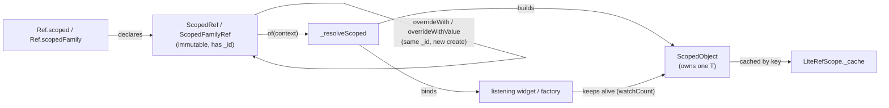
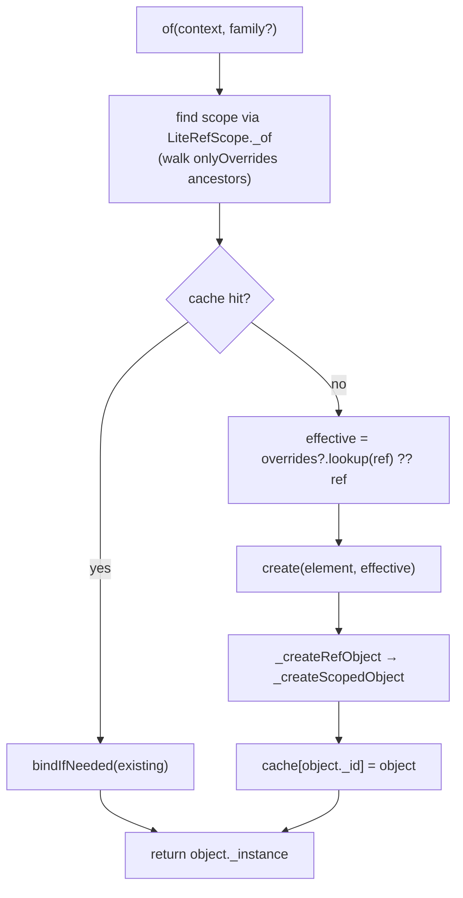
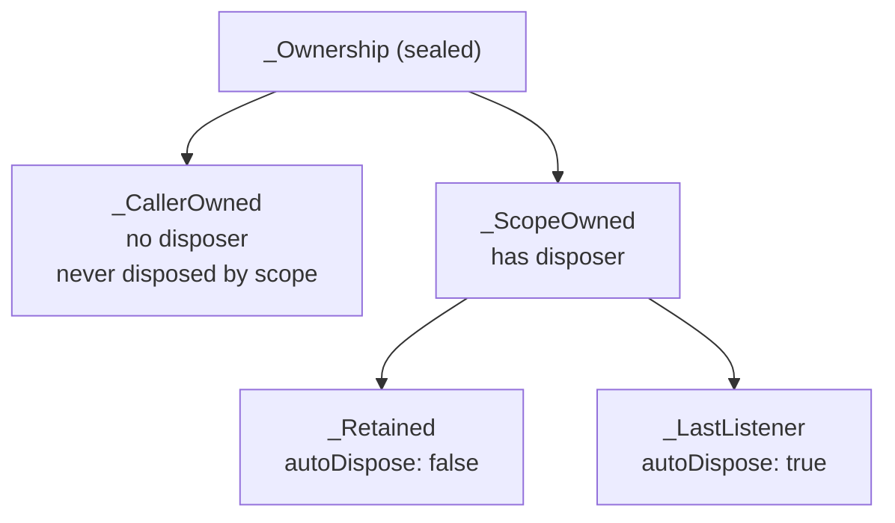
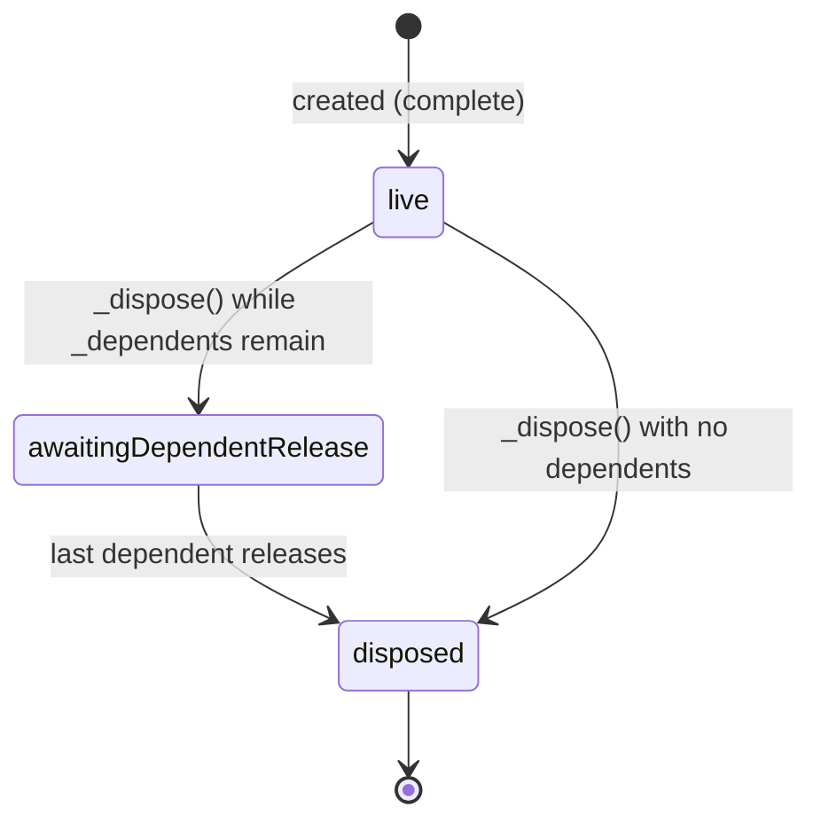
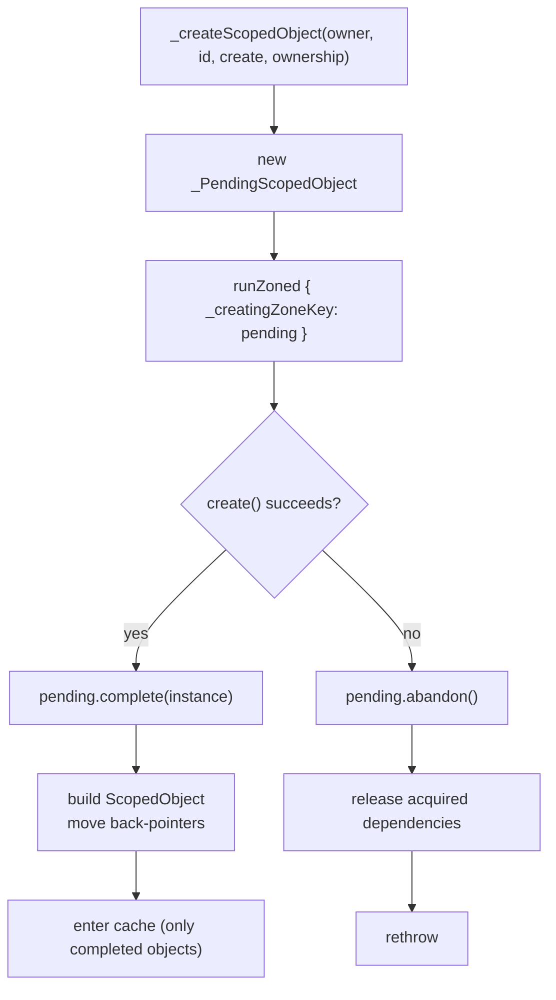
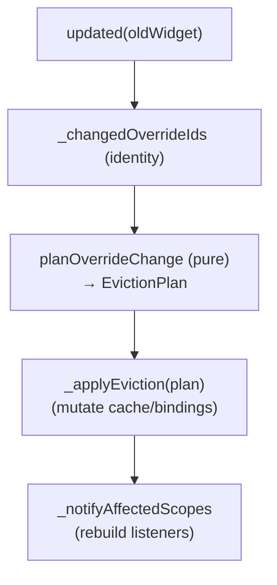

# Architecture: scoped refs

This explains how `ScopedRef`, `ScopedFamilyRef`, and `LiteRefScope` work under
the hood. It covers only the scoped implementation in `packages/lite_ref/lib` —
the `lite_ref_core` package (singletons, transients) is deliberately out of
scope.

## Mental model

There are two kinds of object that look similar but are not:

- **Refs are immutable descriptors.** A `ScopedRef<T>` holds a create function,
  a disposal policy, and an identity token (`_id`). It never holds an instance.
- **Objects hold instances.** A `ScopedObject<T>` is a mutable node that owns one
  `T`, tracks who depends on it, and decides when it dies.

Every scope (`LiteRefScope`) keeps a cache from a *key* to a `ScopedObject`.
Resolving a ref means finding the nearest scope, reading or building the object
for that key, and wiring up whatever is listening. Overrides are just new
descriptor instances that share the same `_id`, so they hit the same cache slot
but build with a different create function.

A guiding design goal is to make invalid states unrepresentable. What can be
pure (which objects to create, invalidate, dispose) is extracted into plain
functions; what must stay impure (the cache, binding maps, notifications,
post-frame scheduling, user disposers) stays in the element.



## File map

All scoped code lives in `packages/lite_ref/lib/src/scoped/` as parts of one
library (`scoped.dart`) so they can share private names:

| File | Owns |
| --- | --- |
| `scoped.dart` | library file; imports and `part` declarations |
| `i_scoped_ref.dart` | public typedefs (`CtxCreateFn`, `DisposeFn`, …) and the sealed `IScopedRef<T>` |
| `scoped_ref.dart` | `ScopedRef<T>` descriptor |
| `scoped_family_ref.dart` | `ScopedFamilyRef<T, F>` descriptor |
| `scoped_lookup.dart` | `_resolveScoped`, the single lookup path, plus `_creationContext` |
| `scoped_object.dart` | `_Ownership`, `_Lifecycle`, `_Dependent`, `ScopedObject`, `_PendingScopedObject`, `_createScopedObject` |
| `scoped_analysis.dart` | lite_ref-specific pure decisions: `_changedOverrideIds`, `_idOf` |
| `eviction.dart` | generic pure planners — `evictionOrder`, `keyBelongsTo`, `EvictionPlan`, `planEviction`, `planOverrideChange` (imported, not a part, so widget-free testable) |
| `scope_widget.dart` | `LiteRefScope` (the `InheritedWidget`) and `_RefScopeElement` (all Flutter effects) |

`src/ref.dart` holds the `Ref` static factories (`scoped`, `scopedFamily`, and
the pass-throughs to `lite_ref_core`). `lib/lite_ref.dart` is the public
surface; everything else is private.

## Ref identity and overrides

- `ScopedRef._id = Object()` — a fresh identity per declaration.
- `overrideWith` / `overrideWithValue` return a *new* `ScopedRef` that copies
  `_id` and the disposer, but swaps the create function or marks it caller-owned.
- Equality is by `_id`, so two overrides of the same ref are `==`. Because of
  this, change detection must compare by identity, not equality (see
  `_changedOverrideIds`).
- The cache key is `_id` for a `ScopedRef`, and `(_id, family)` for a
  `ScopedFamilyRef`. Dependency *lookup* tracking always uses the bare `_id`,
  never the family — families share a lookup path.

## Lookup (`_resolveScoped`)

One function serves both ref types. Parameters are the context, the descriptor,
a bare `lookupId`, a `cacheKey`, a `listen` flag, and a `create` callback that
knows how to build the object for the *effective* ref.

1. Find the serving element with `LiteRefScope._of`, which also returns any
   `onlyOverrides` scopes traversed along the way.
2. If the cache has the key, bind the listener to the existing object and return
   its instance.
3. Otherwise resolve `effective = overrides?.lookup(ref) ?? ref`, build the
   object, bind, cache it, and return.

Binding has three modes, distinguished by who is asking:

- `listen: false` (a `read`) — no binding at all.
- Inside a factory — record an object dependency instead of binding the widget.
- A listening widget — `_addDependent` on every traversed scope, then
  `element._bind(context, object)`.



The `create` callback is what makes the unified resolver safe: `ScopedRef` casts
`effective` to `ScopedRef<T>`, `ScopedFamilyRef` to `ScopedFamilyRef<T, F>`, so
each keeps its own `_createRefObject`.

## Ownership and lifecycle

Ownership is a sealed hierarchy (`_Ownership<T>`) whose variants are the only
valid combinations:



- `_CallerOwned<T>` — built by `overrideWithValue`; carries **no** disposer, so
  the scope structurally cannot dispose it. It still releases dependencies.
- `_Retained<T>` (`autoDispose: false`) — scope-owned, disposed on scope unmount
  or override replacement, but not when listeners leave.
- `_LastListener<T>` (`autoDispose: true`) — scope-owned; also disposed when the
  last listener goes away.

A `ScopedObject` additionally has a `_Lifecycle` enum — `live`,
`awaitingDependentRelease`, `disposed` — with no other states.



`_dispose()`:

1. Already `disposed` → return.
2. Still has `_dependents` → mark `awaitingDependentRelease` and return; the
   last dependent to release it completes the disposal.
3. Otherwise mark `disposed`, run the disposer (only for `_ScopeOwned`: explicit
   `dispose`, else `Disposable`, else `ChangeNotifier`), and finally release
   dependencies.

<details>
<summary>Why <code>awaitingDependentRelease</code> is needed</summary>

`awaitingDependentRelease` is entered in exactly one place, the `_dispose()`
guard `if (_dependents.isNotEmpty)`. So it takes a **forced disposal of a
dependency while a live `ScopedObject` still lists it in `_dependents`**. Object
dependents already increment `_watchCount` (`_addObjectDependency`), so ordinary
"last listener went away" cleanup can never land here — only unmount or
eviction, which dispose regardless of `_watchCount`.

### Scenario: a scope unmounting with a dependency chain

```dart
final dbRef = Ref.scoped<Db>((_) => Db(), dispose: (db) => db.close());
final repoRef = Ref.scoped<Repo>(
  (ctx) => Repo(dbRef(ctx)),           // repo depends on db
  dispose: (repo) => repo.flush(),     // flush() still talks to db
);

// some LiteRefScope containing this:
Builder(builder: (ctx) {
  repoRef(ctx);                        // creates db, then repo
  return const SizedBox.shrink();
});
```

Now navigate away, or remove that `LiteRefScope` (a `testWidgets` teardown does
the same).

Cache order is insertion order (`_Cache` is a `Map`), and the dependency is
created during the dependent's factory, so the cache is `[db, repo]`.
`unmount()` disposes `_cache.values` in that order:

1. `db._dispose()` → `db._dependents == {repo}` → `live →
   awaitingDependentRelease`, returns. `db.close()` is **not** called.
2. `repo._dispose()` → `repo.flush()` runs while `db` is still open; that is the
   whole point.
3. `repo`'s `finally` calls `_releaseDependencies()`, which removes `repo` from
   `db._dependents`, sees `awaitingDependentRelease`, and calls
   `_disposeSafely(db)` → `live → disposed`, `db.close()` runs.

Result: `repo`'s disposer observes a usable `db`, and `db` is torn down last.
Without the intermediate state, unmount order (dependency before dependent)
would close `db` underneath `repo.flush()`.

### Scenario: eviction across scopes

Eviction does *not* normally reach this state, even when the dependency and
dependent live in different scopes. `evictionOrder` emits dependents first, and
`_applyEviction` walks the plan in that order, queueing each object on its own
owner's `_evictedRefs`. The dependent's scope therefore registers its flush
callback first, so the dependent is disposed first and releases the dependency
before the dependency's queue is drained. A cross-scope eviction mirrors the
single-scope assertion: the dependent's disposer still sees a live dependency.

The state is the backstop for any forced disposal that is *not* ordered this
way. Scope unmount is the concrete one above: cache order is insertion order,
so dependencies come before the dependents that created them. Whenever such a
path reaches a dependency first, the guard parks it in
`awaitingDependentRelease` instead of tearing it down under a live dependent.

**Short version:** any `Ref.scoped` whose factory resolves another scoped ref,
with both entries dying in the same scope teardown, deterministically passes
through `awaitingDependentRelease` — because the dependency is both created and
cached before its dependent, and `unmount` disposes in cache order.

</details>

## Creation (`_PendingScopedObject`)

Factories run in two phases so a half-built object can never enter the cache:

- `_createScopedObject` creates a `_PendingScopedObject` (a `_Dependent`, not
  yet a `ScopedObject`), then runs `create()` inside
  `runZoned(zoneValues: {_creatingZoneKey: pending})`.
- On success, `pending.complete(instance)` builds the real `ScopedObject` and
  moves its back-pointers: every dependency's `_dependents` swaps `pending` for
  the new object, and lookup registrations are copied over. A pending object is
  only ever a dependent, never a dependency, so this fix-up is one-directional.
- On throw, `pending.abandon()` releases the dependencies the failed factory had
  already acquired, then rethrows.

The running factory is tracked with a `Zone` value rather than a global list.
This means a factory may resolve dependencies through *any* `BuildContext` it
captured, not only the `ctx` parameter, and nothing can leak between scopes or
tests. The `_active` flag is cleared on `complete`/`abandon` so asynchronous
continuations that escape the factory cannot register dependencies after the
fact.



<details>
<summary>Why <code>_PendingScopedObject</code> is needed</summary>

The root cause is that `ScopedObject._instance` is `final` and has no value
until `create()` returns. A `ScopedObject` cannot exist before its value does,
yet the factory may already be resolving dependencies, and those dependencies
need a dependent identity *right now* (`_addObjectDependency` adds an entry to
`dependency._dependents` and bumps `_watchCount`). `_PendingScopedObject` is
that identity: it carries the creation-time data that *is* known (`id`, `owner`,
`ownership`) and the dependent-side bookkeeping (`_dependencies`,
`_lookupRegistrations`), but no instance.

### Scenario: a factory that resolves a ref and then throws

```dart
final configRef = Ref.scoped((_) => loadConfig());
final clientRef = Ref.scoped((ctx) {
  final config = configRef(ctx);         // records pending as config's dependent
  if (config.invalid) throw StateError('bad config');
  return Client(config);
});
```

`config` is created and enters the cache normally. `clientRef` never does.

1. While `create()` runs, `_creationContext()` reads the zone value and returns
   the pending object. Lookups inside the factory record it as the dependent,
   not the consuming `Element`.
2. If the factory throws, `pending.abandon()` releases exactly those edges:
   `config._dependents` drops the pending object and `_watchCount` decrements,
   so an `autoDispose` config is not leaked by a consumer that never existed.
   The exception is rethrown and the cache is untouched.
3. If the factory succeeds, `pending.complete(instance)` constructs the real
   `ScopedObject` and rewrites every dependency's `_dependents` entry and every
   lookup registration from `pending` to the new object, then clears the
   pending side.

The fix-up is one-directional because a pending object is never in a cache, so
no one can hold *it* as a dependency; only the pending object's outbound
references need moving. That is also why `complete()` can assert that pending
appears in each dependency's `_dependents` but never the reverse.

### Why not create the object first and cache it after?

Because a half-built object must never be observable. `_resolveScoped` inserts
into `_cache` only after `create(...)` returns
(`element._cache[object._id] = object`), and a throwing factory leaves no
entry. Disposal is likewise safe: `_dispose()` operates on a `ScopedObject`
whose `_instance` is guaranteed initialized; a pending object is not a
`ScopedObject` and has no lifecycle or disposer to run.

### Why the `_active` flag

Zone values follow asynchronous continuations. Without `_active`, a
`Future.then` scheduled inside a factory could resolve a ref after the factory
already completed or failed, attaching a dependency to an object that is
already live (or disposed). `_creationContext()` returns `null` once
`complete()` or `abandon()` clears the flag, so a late lookup is treated as an
ordinary one (cached hit, or a fresh creation) instead of mutating the finished
object's dependency graph.

**Short version:** `_PendingScopedObject` lets a factory acquire and release
dependencies before its value exists, keeps failed creations out of the cache,
and moves the surviving edges onto the real `ScopedObject` when creation
succeeds.

</details>

## Binding and auto-dispose

Each `_RefScopeElement` keeps:

- `_cache` — key → `ScopedObject`.
- `_listeningElements` — widgets that read a ref through this scope.
- `_autoDisposeBindings` — element → set of objects it keeps alive.
- `_consumerBindings` — a global `Expando<Map>` keyed by element, mapping ref
  key → the scope that currently serves it. Needed because a scope switch (an
  `onlyOverrides` scope gaining an override) must release the stale binding in
  the old scope while the widget stays mounted. On `removeDependent` only the
  entries whose value is `identical` to *this* scope are dropped.

`ScopedObject._watchCount` counts how many widgets/elements hold a listener.
When it drops below 1, `_scheduleDisposal` queues the object; a post-frame flush
drains `_pendingDisposals` and `_evictedRefs`, re-checking `_watchCount > 0`
first so a widget moved with a `GlobalKey` in the same frame keeps its instance.

<details>
<summary>Why binding is per element and disposal is deferred</summary>

Two separate problems are solved here: knowing *which* element keeps *which*
object alive, and *when* it is safe to dispose that object. A plain refcount
can answer "is anyone still using this?" but not "which binding belongs to the
element that is going away?", and an immediate decrement cannot survive a
widget that leaves one parent and re-enters another within the same frame.

### Scenario: a mounted consumer switches scopes

A widget stays mounted, but an `onlyOverrides` scope above it gains an override
for the ref it reads:

```dart
LiteRefScope(
  overrides: {countRef.overrideWith((_) => 1)},
  child: LiteRefScope(
    onlyOverrides: true,
    overrides: current.value == 0 ? null : {countRef.overrideWith((_) => 2)},
    child: consumer, // never unmounts
  ),
)
```

1. Initially `consumer` binds `countRef` to the outer scope, and
   `_consumerBindings[consumer][key]` records the outer scope.
2. The inner scope's override change has nothing cached to evict, but it still
   notifies its listening elements (the consumer): gaining an override changes
   which scope serves the ref.
3. `consumer` rebuilds and resolves through the inner scope. `_bind` sees the
   previous owner is the outer scope and calls
   `previous._releaseBinding(consumer, key)`, which decrements the outer
   object's `_watchCount` and schedules its disposal.
4. The old instance is disposed even though the element never unmounted. The
   regression test asserts `disposed == [1]` before the scope ever tears down.

This is why `_consumerBindings` is a global `Expando` keyed by the element
rather than a field on one scope: `_bind` must find the previous owner even
though that binding was created by a different scope element, and
`removeDependent` must drop only this scope's entry while the element lives on.
The `identical(scope, this)` filter matters because one element can hold
bindings in several scopes (an `onlyOverrides` chain), and only the stale one
may be released.

### Scenario: a widget moves with a `GlobalKey`

1. During a build, the keyed widget leaves its old parent. Flutter deactivates
   it, `removeDependent` runs, `_watchCount` hits 0, and `_scheduleDisposal`
   queues the object.
2. In the same build, the widget is inserted under its new parent, resolves the
   ref again, and `_addAutoDisposeBinding` brings `_watchCount` back to 1.
3. The post-frame flush re-checks `_watchCount > 0` and skips the queued
   object. Disposing immediately in step 1 would have torn down an instance the
   same frame reuses.

The same queue also covers release cascades (`_releaseDependencies` can enqueue
a dependency from inside a disposer) and cross-scope releases, which is why the
flush drains wave after wave instead of waiting for another frame.

### What is deliberately not bound

`read` (`listen: false`) and `autoDispose: false` values create no
`_autoDisposeBindings` entry. A read does not keep the value alive past the
scope, and a `_Retained` value is disposed only on scope unmount or override
replacement, never because its last listener left.

**Short version:** bindings live on the element so they can be released even
when the widget stays mounted, and actual disposal is deferred to a post-frame
flush that re-checks the count, so the frame that moves a widget cannot dispose
the instance it reuses.

</details>

## Invalidation and eviction

Invalidation is a pure "decide, then apply" split: the planners in `eviction.dart`
return an `EvictionPlan`, and the element only applies it.



1. `_changedOverrideIds` — ids whose override was added, removed, or replaced
   (identity comparison).
2. `planOverrideChange` — a generic pure planner that selects the objects to
   evict (keys matching a changed id; if switching to `onlyOverrides`, everything
   not in the override set; plus lookup dependents of changed ids) and orders
   them dependents-first via `evictionOrder`. It returns an `EvictionPlan` with
   `toEvict` (ordered) and `affectedScopes` (`{owner} ∪ owners(toEvict)`).
   `keyBelongsTo` matches cache keys against bare ref ids.
3. `_applyEviction(plan)` — a dumb applier: evicts each object in `plan.toEvict`
   (removes it from the cache and bindings, queues it for disposal). It computes
   nothing.
4. `_notifyAffectedScopes` — rebuilds listening elements in every scope in
   `plan.affectedScopes`, including `autoDispose: false` consumers.

`activate()` reuses the same split with `planEviction` (it has no override-change
inputs, so it computes its own roots) and skips notification when `plan.toEvict`
is empty. Moving the *what* into the pure planners and leaving the *how* in the
element is what makes invalidation unit-testable without a widget tree.

## `onlyOverrides` traversal

A `LiteRefScope(onlyOverrides: true)` serves only refs present in its `overrides`
set. `_of` walks up through `onlyOverrides` ancestors until it finds one that
serves the ref, recording the traversed scopes so their override changes can
still notify this consumer. The root scope must have `onlyOverrides: false`.

## Invariants to preserve

- A pending object is only a dependent, never a dependency, and never in a cache.
- Only a completed object enters the cache — including one whose value is
  legitimately `null`.
- Family cache keys are `(_id, family)`; lookup-dependency keys are bare `_id`.
- Caller-owned values are never disposed by a scope, but their dependencies are
  still released.
- An evicted dependency stays usable by its dependents' disposers until the last
  dependent releases it (`awaitingDependentRelease`).
- Explicit disposers receive a successfully created `null` value exactly once.

## Tests

- `test/src/scoped/ref_test.dart` — the behavioral spec, including the
  `scoped lifecycle regressions` group.
- `test/public_api_test.dart` — imports only `lib/lite_ref.dart`; a canary for
  accidental library-private coupling.
- `test/src/scoped/eviction_test.dart` — widget-free tests of the pure planners
  (`evictionOrder`, `keyBelongsTo`, `planEviction`, `planOverrideChange`).

When you add a private state that is unreachable by construction, coverage will
flag it; exercise it from a test or mark it `// coverage:ignore` deliberately.
